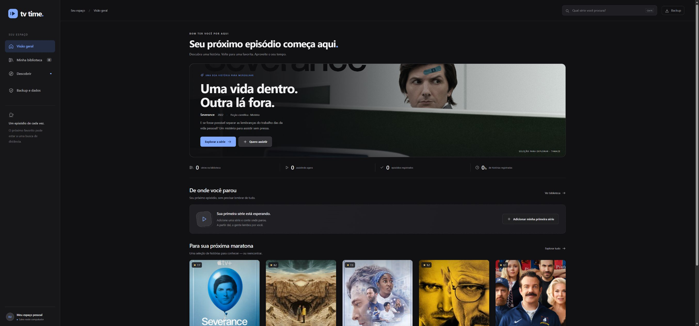

# TV Time pessoal

Um diário de séries para usar no computador: lembrar o episódio em que parou, reconstruir o que já assistiu e descobrir a próxima história. Interface em português, sem cadastro, anúncios ou chave de API.

Este é um projeto pessoal independente, sem vínculo com o antigo serviço TV Time.



**Vai trocar de computador?** Siga o [guia de retomada no PC novo](docs/RETOMADA_NOVO_COMPUTADOR.md). Ele inclui os passos para abrir o app e uma mensagem pronta para continuar o projeto com o Codex.

## Começar no Windows

1. Instale o **Node.js 24 LTS ou mais recente** pelo [site oficial](https://nodejs.org/).
2. Baixe ou clone este repositório.
3. Dê dois cliques em **`Iniciar TV Time.cmd`**.

O app abre no navegador em **http://127.0.0.1:4317**. Depois de reiniciar o computador, abra o mesmo arquivo novamente. Não é necessário instalar pacotes. O servidor roda em segundo plano, somente neste computador.

Alternativa para quem usa terminal:

```sh
npm start
```

No macOS/Linux, use o comando acima e abra o endereço no navegador. Feche o processo com `Ctrl+C`.

## Primeiro uso

1. Busque uma série pelo nome na barra superior (`Ctrl+K` leva à busca).
2. Confira título e ano e clique em **Começar a assistir** ou **Quero assistir**.
3. Se já viu alguns episódios, abra **Lembro onde parei**, escolha temporada e episódio e clique em **Assisti até aqui**.
4. O próximo episódio aparecerá em **De onde você parou**.

Também é possível registrar temporadas inteiras, desfazer marcações, mudar o status, dar nota de 1 a 10 e escrever anotações. Marcar um status manualmente não altera os episódios registrados. O botão de concluir um episódio na página inicial registra que você acabou de assistir; ao reconstruir o histórico, a data original de visualização fica desconhecida.

## Código no GitHub; histórico no seu computador

O repositório guarda o **projeto**. Sua biblioteca fica em **`data/library.sqlite`**, fora do Git. Fechar ou limpar o navegador não apaga o histórico. Excluir a pasta `data`, perder o disco ou trocar de computador sem backup pode apagá-lo.

O app cria cópias JSON em `data/backups/`:

- `biblioteca-atual.json`: a biblioteca após a última alteração.
- `antes-da-ultima-alteracao.json`: estado imediatamente anterior.
- `inicio-do-dia-AAAA-MM-DD.json`: estado antes da primeira alteração daquele dia.

Esses backups locais protegem de alterações acidentais, **não de perda do computador**. Faça uma exportação em **Backup e dados → Baixar meu backup** e guarde em Google Drive, OneDrive ou outro dispositivo. O app não envia o histórico à nuvem automaticamente.

### Trocar de computador

1. No computador antigo, se já tiver registrado séries, baixe o backup pelo app e guarde fora dele. Se a biblioteca estiver vazia, pule esta etapa.
2. No novo, instale o Node.js e baixe este repositório.
3. Abra `Iniciar TV Time.cmd`.
4. Em **Backup e dados → Trazer minha biblioteca**, selecione o JSON exportado.

A importação **mescla** as bibliotecas: conserva as séries atuais e soma os episódios assistidos. Ela não desfaz marcações presentes no destino. Para recuperar uma cópia exata, encerre o servidor e use uma nova pasta de dados antes de importar, preservando a pasta antiga. Mais detalhes em [docs/CONTINUIDADE.md](docs/CONTINUIDADE.md).

**Não envie `data/`, bancos, backups pessoais ou credenciais para este repositório público.**

## Catálogo e descoberta

- Busca real, séries, temporadas, episódios, pôsteres e sinopses: [TVMaze](https://www.tvmaze.com/api), sob [CC BY-SA](https://creativecommons.org/licenses/by-sa/4.0/). Os dados do catálogo mantêm essa licença; o código do app é independente.
- **Seleção para você**: coleção editorial inicial de séries, sem alegação de popularidade atual.
- **Pelo seu gosto**: reordena essa coleção por afinidade de gêneros com sua biblioteca e retira séries já adicionadas; não é um modelo de IA.
- **Episódios de hoje**: programação global de streaming fornecida pelo TVMaze; não comprova disponibilidade no Brasil.
- Sinopses podem estar em inglês e títulos de episódios no idioma original. Tente o nome original na busca quando o título em português não aparecer.
- O canal de origem de uma série **não** é uma lista atual de onde ela está disponível para streaming.
- A biblioteca e seus episódios continuam acessíveis sem internet. Novas buscas, imagens e atualizações de catálogo precisam de conexão; respostas já consultadas têm cache local.

Ainda não há filmes, comentários de comunidade, ranking de séries mais comentadas, sincronização automática de histórico na nuvem ou alertas em segundo plano. O app registra o que você assiste; não reproduz vídeos.

## Publicação na internet

O aplicativo continua local. Vercel e Supabase foram discutidos como possibilidades, mas a publicação, o login e a sincronização online ainda não foram implementados. Os plugins dessas plataformas foram sugeridos; sua conexão não foi confirmada. Nenhuma conta desses serviços é necessária para abrir a versão atual em outro computador. O [guia de continuidade](docs/CONTINUIDADE.md) registra esse ponto para a próxima sessão.

## Desenvolvimento

Node.js 24+, servidor HTTP e SQLite nativos, JavaScript e CSS sem compilação ou dependências externas.

```sh
npm run check
npm test
npm start
```

As verificações também rodam pelo GitHub Actions no Windows e no Linux.

```text
server.mjs             Rotas HTTP e regras de progresso
lib/model.mjs          Validação, normalização e cálculo de progresso
lib/store.mjs          SQLite, exportação, importação e backups
lib/catalog.mjs        Cliente TVMaze, cache e limite de consultas
public/                Interface, estilos e ícone
tests/                 Testes de dados, recuperação e segurança local
scripts/start.ps1      Inicializador do Windows
docs/                  Decisões e continuidade
data/                  Histórico privado (ignorado pelo Git)
```

Configurações opcionais de processo: `PORT` (padrão 4317) e `TV_TIME_DATA_DIR` (pasta de dados; padrão `data/`). Não exponha o servidor à internet: ele foi feito para uso individual na interface de loopback.
